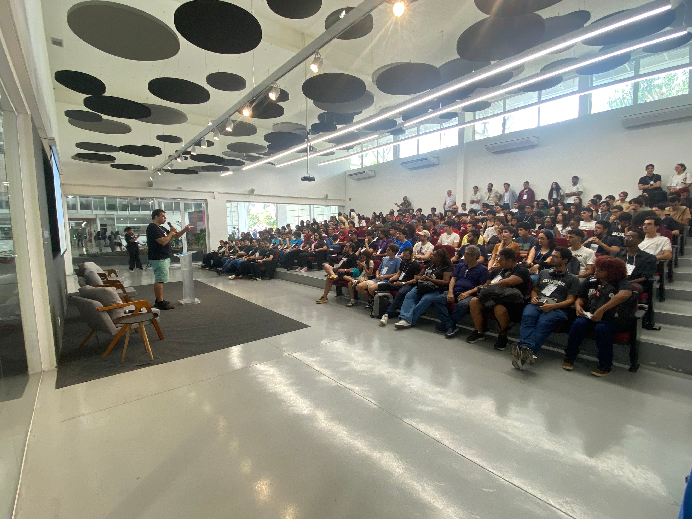
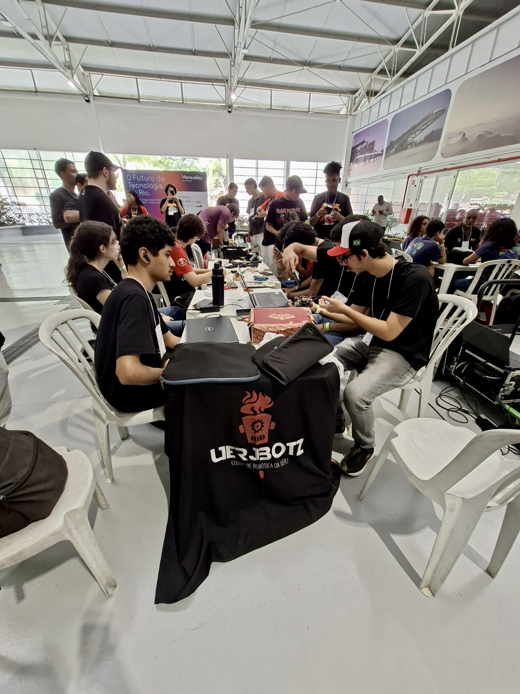
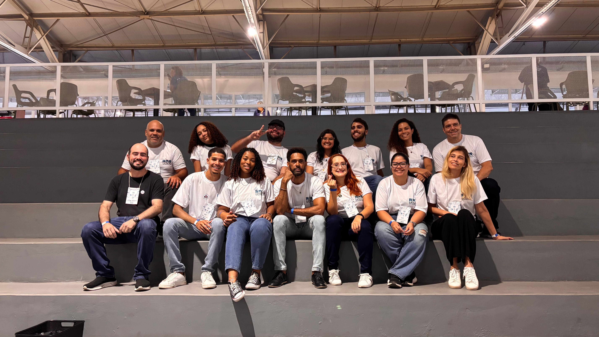

+++
title = "Arduino Day 2026 — O Futuro é Feito Aqui!"
description = "Realizado"
draft = false
date = "2026-04-25"

[extra]
status = "Realizado"
tags = [
    "robótica",
    "educação",
    "comunidade",
    "open source",
]
location = "Maravalley — R. Equador, 335, Santo Cristo, Rio de Janeiro/RJ"
audience = "Mais de 500 participantes"
partners = "UERJ Sats, GFRJ, Galileu Robotics, Planetário OBA"
highlight = false
external_link = ""
+++

# Sobre o evento
O **Arduino Day 2026: O Futuro é Feito Aqui!** ocupou o Maravalley por um dia inteiro e transformou o espaço em um ponto de encontro para quem gosta de criar, experimentar e aprender tecnologia na prática.
A programação foi pensada para diferentes níveis de curiosidade. Teve palestras para situar o tema, oficinas para colocar a mão na massa, competições para testar limites e exposições para ver de perto o que a comunidade vem construindo. Foi um dia feito por muita gente, e para muita gente.
## O evento em números
- **Mais de 500 participantes**
- **12 oficinas práticas**, com **200 vagas** disponíveis.
- **9 palestrantes** convidados.
- **13 grupos de exposição** e mais de **25 projetos** apresentados.
- **17 voluntários** na produção do evento.
- **3 parceiros** apoiando estrutura e atividades.
## Experiências e atividades
- Palestras com makers, docentes e especialistas em ciência e tecnologia.
- Oficinas práticas de eletrônica, IoT, software livre, hardware hacking e satélites.
- Exposições de foguetes, satélites, sensores, placas eletrônicas e robôs.
- Competições de robótica realizadas com a **Galileu Robotics**.
- Espaço Kids Maker, com atividades para crianças de até 14 anos.
- Roda Maker: educação tecnológica no Brasil, com **45 participantes**.
## Destaques da exposição
- **UERJ Sats:** satélites, placas de circuito e sistemas de antenas.
- **GFRJ:** foguetes, paraquedas e tecnologias de lançamento.
- **Geração de Entropia Física:** experiências com sensores, aleatoriedade e criptografia.
- **Ambientes de realidade virtual** e demonstrações interativas para diferentes idades.
## Um evento feito em comunidade
Quem passou pelo Maravalley naquele dia viu uma mistura rara de encontrar no mesmo espaço: crianças montando seus primeiros circuitos, famílias inteiras, estudantes de escolas e universidades, profissionais da área e gente que nunca tinha tocado em uma placa de prototipagem. As bancadas viraram pontos de conversa, e as perguntas eram menos sobre o resultado e mais sobre o caminho até ele.

Nada disso teria acontecido sem muita gente envolvida. Teve voluntários que montaram e desmontaram o espaço, grupos de pesquisa e coletivos independentes que trouxeram seus projetos, parceiros que garantiram a estrutura e equipes que explicaram seus protótipos quantas vezes fossem necessárias.

O Arduino Day expressa uma ideia central do Rio Maker Space: tecnologia se aprende melhor quando o conhecimento circula, o processo é compartilhado e todas as pessoas são convidadas a colocar a mão na massa.
## Tecnologia aberta em movimento
Cada oficina, protótipo e conversa fortaleceu uma rede formada por comunidades, instituições de ensino, grupos de pesquisa e iniciativas independentes. É assim que construímos eventos abertos, educativos e capazes de inspirar os próximos projetos.









