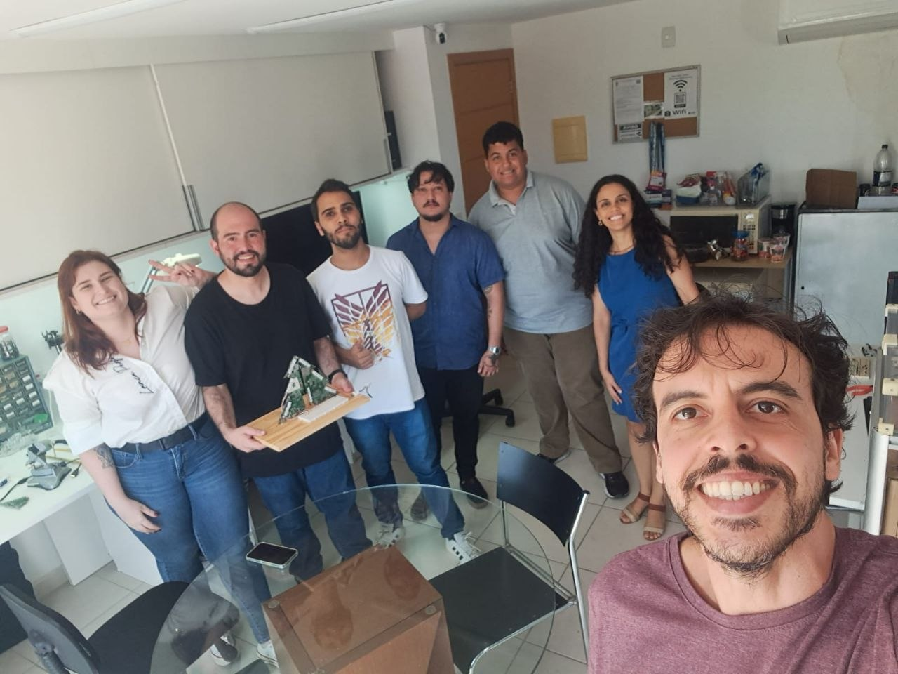
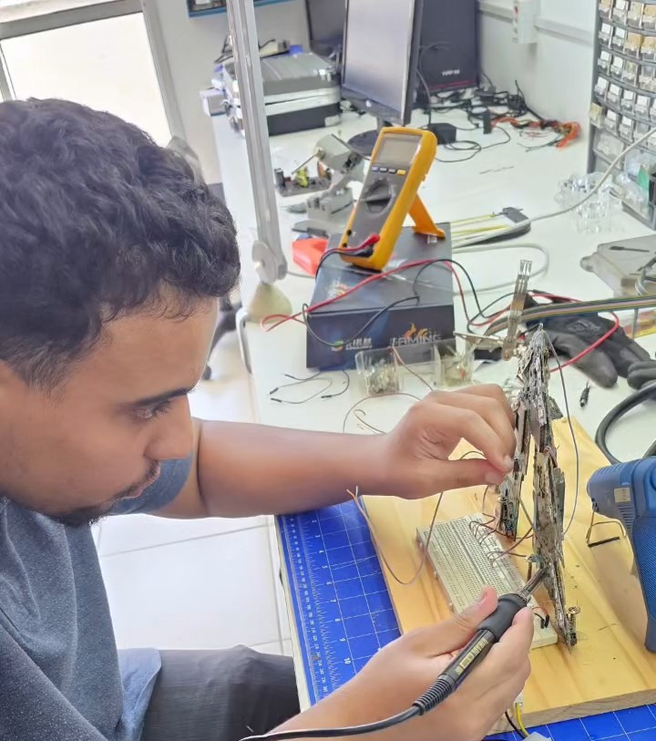
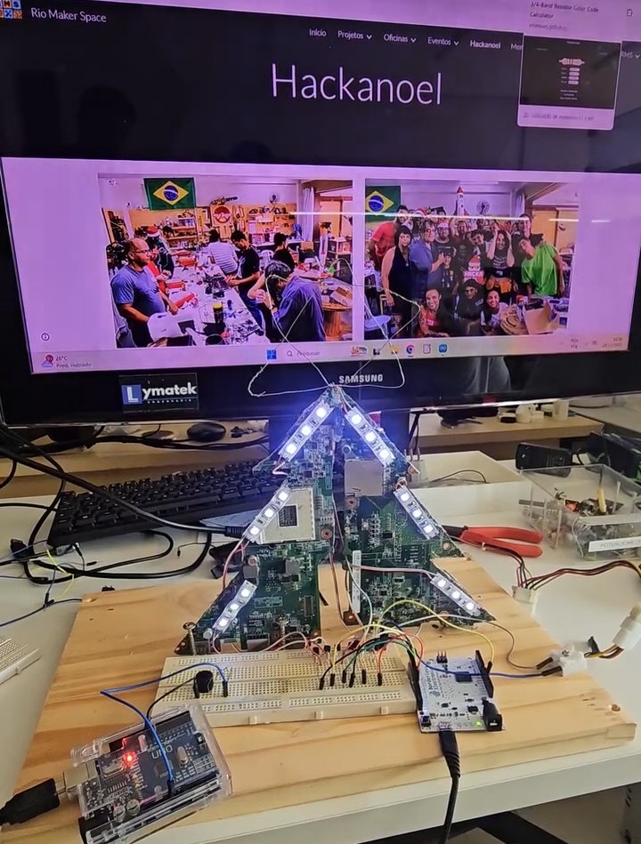
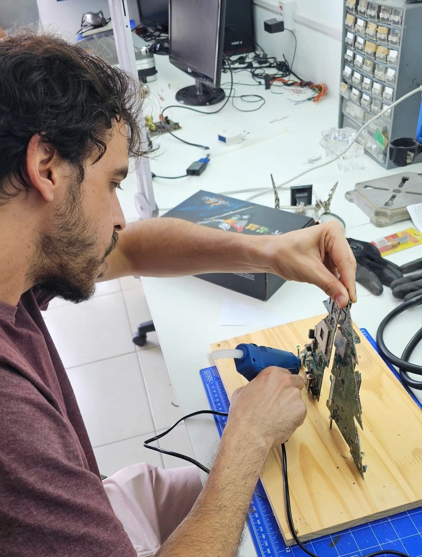
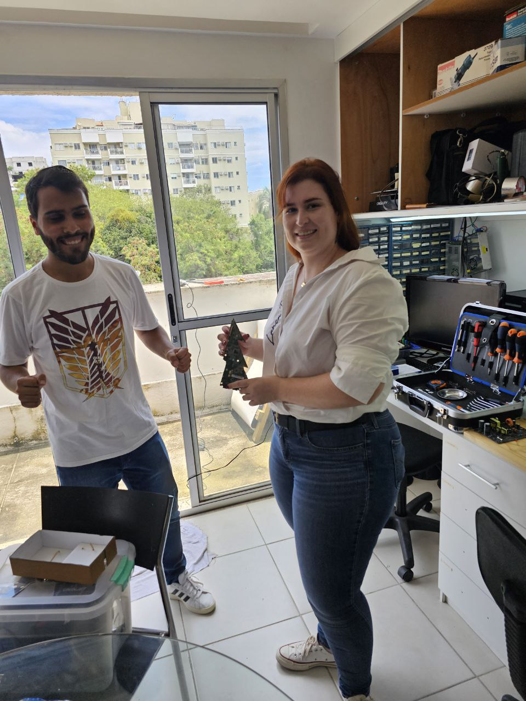
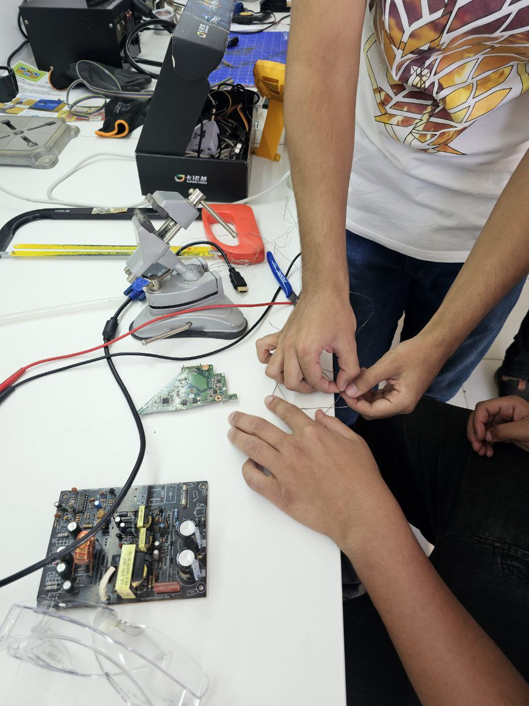

+++
title = "Hackanoel 2025"
description = "Realizado"
date = 2025-12-20
draft = false

[extra]
status = "Realizado"
tags = [ "sucata", "natal", "comunidade" ]
location = ""
audience = ""
partners = ""
highlight = false
external_link = ""
+++

O Hackanoel é um evento de criação de brinquedos e projetos feitos com materiais recicláveis com tema natalino. Famílias se reúnem para construir juntas usando sucata, papelão, garrafas PET, cola quente e o que estiver à mão. Sem manual, sem certo ou errado, cada um cria do seu jeito. O que vale é botar a mão na massa e o tempo compartilhado.

## Fotos






















